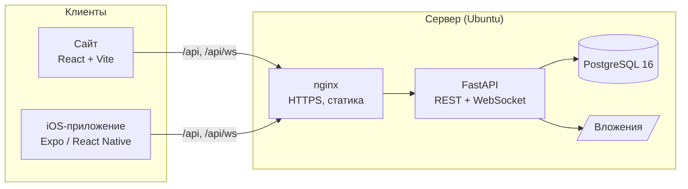
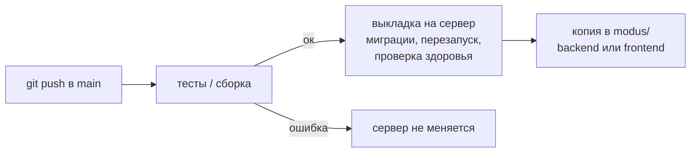

<div align="center">


<br><br>

**Идея сотрудника не должна теряться в чатах.**<br>Сотрудник пишет о проблеме или предлагает улучшение. Обращение само уходит ответственному,<br>а автор видит, как его рассматривают и чем всё закончилось.

<br>

**[🌐 Открыть демо](https://modus-trade.makquiz.site)** &nbsp;·&nbsp; **[⚙️ Бэкенд](https://github.com/Modus-trade/modus-back)** &nbsp;·&nbsp; **[🎨 Сайт](https://github.com/Modus-trade/modus-front)** &nbsp;·&nbsp; **[📋 Соответствие ТЗ](docs/tz.md)** &nbsp;·&nbsp; **[📖 Документация](docs/product.md)**

<sub>Сайт · iOS-приложение · живые уведомления · автодеплой</sub>

</div>

<br>

---

## 📑 Содержание

- [Как попробовать](#-как-попробовать)
- [Что умеет система](#-что-умеет-система)
- [Как устроено](#-как-устроено)
- [Репозитории и процесс разработки](#-репозитории-и-процесс-разработки)
- [Запуск у себя](#-запуск-у-себя) · [Windows с нуля](#windows-с-нуля-vs-code)
- [Проверки](#-проверки)
- [Документация](#-документация)

## 🚀 Как попробовать

Откройте **https://modus-trade.makquiz.site** и войдите любым аккаунтом. Пароль у всех: `demo1234`.
На странице входа есть кнопки ролей, которые заполняют форму.

| Роль | Email | Что увидит |
| --- | --- | --- |
| Сотрудник | `employee@modus.demo` | только свои обращения |
| Руководитель закупок | `manager.procurement@modus.demo` | обращения своего отдела и назначенные ему |
| Администратор | `admin@modus.demo` | всё, плюс центр внимания и настройки |

Ещё руководители: `manager.sales`, `manager.accounting`, `manager.design`, `manager.it`, `manager.office`.
Ещё сотрудники: `employee.sales`, `employee.accounting`, `employee.design`, `employee.it`, `employee.office` (все `@modus.demo`).

### Сценарий за 3 минуты

1. **Сотрудник** создаёт предложение в категории «Межотдельное взаимодействие». Форма сразу показывает, назначится ли ответственный автоматически и к какому сроку ждать ответ.
2. **Руководитель закупок** у себя в другом окне сразу получает уведомление 🔔, открывает обращение и задаёт уточняющий вопрос. Статус меняется на «Ожидает уточнения».
3. **Сотрудник** получает уведомление о вопросе и отвечает. Обращение возвращается на рассмотрение.
4. **Руководитель** ставит «Реализовано» и пишет результат. Без результата завершить нельзя: это проверяют и форма, и сервер.
5. **Сотрудник** видит итог и полную историю изменений.

## ✨ Что умеет система

**Для сотрудника**
- Подача идеи, проблемы или вопроса в несколько полей, с фото и файлами (PDF, PNG, JPG, DOCX, XLSX, TXT, до 10 МиБ).
- Подсказка «похожие проблемы»: если о том же уже написали, можно присоединиться к существующему обращению, а не создавать дубль.
- Понятный путь обращения: Подано → Рассмотрение → Реализация → Решение, с мотивированным результатом.

**Для руководителя**
- Входящие с автоматической маршрутизацией по категории и сроком первого ответа (SLA).
- Обсуждение, запрос уточнения, смена статуса, приоритета и ответственного, история всех изменений.
- Рекомендации исполнителей и поиск с фильтрами по типу, категории, статусу, приоритету, отделу и просрочке.

**Для администратора**
- Центр внимания: обращения без ответственного, с просроченным первым ответом и без движения.
- Аналитика по типам, категориям, статусам и времени ответа.
- Управление категориями (ответственный, SLA) и пользователями (роли, отделы, отключение без потери истории).

**ИИ-помощник**
- При подаче: по теме, описанию и фото ИИ сам ставит тип и категорию и показывает, кому уйдёт обращение и почему. Сотрудник может поменять выбор вручную.
- Ответственному: блок «Похожие обращения» (что уже было и как решили) и кнопка «Предложить решение» — суть, шаги и черновик ответа автору. Отправляет всегда человек.
- Подробнее: [docs/ai.md](docs/ai.md).

**Везде**
- Живые уведомления по WebSocket: назначение, комментарий, вопрос, смена статуса, результат. На сайте это колокольчик с непрочитанными, на iPhone системное уведомление; переход ведёт прямо в обращение.
- Права проверяет сервер, в том числе на скачивание файлов. Закрытое обращение изменить нельзя.

## 🏗 Как устроено



Сайт и приложение работают через один API и одну базу, так что данные, аккаунты и права у них общие.

| Часть | Технологии |
| --- | --- |
| Бэкенд | Python 3.12, FastAPI, SQLAlchemy 2, Alembic, Pydantic v2, JWT в httpOnly cookie, bcrypt-SHA256 |
| Живые события | WebSocket `/api/ws`; события отправляются только после успешного коммита в базу |
| Сайт | React 18, TypeScript, TanStack Query, React Router, React Hook Form + Zod, Recharts, Tailwind |
| iOS-приложение | Expo SDK 58, expo-router, нативный таб-бар iOS 26 (Liquid Glass), SwiftUI-контролы, Reanimated |
| База | PostgreSQL 16 на сервере, SQLite локально (без настройки) |
| Инфраструктура | nginx + Let's Encrypt, systemd, GitHub Actions |

## 🔄 Репозитории и процесс разработки

| Репозиторий | Что внутри |
| --- | --- |
| **[modus](https://github.com/Modus-trade/modus)** (этот) | весь проект целиком: `backend/`, `modus-front/`, `mobile/`, документация, Docker |
| [modus-back](https://github.com/Modus-trade/modus-back) | бэкенд, здесь пишется его код |
| [modus-front](https://github.com/Modus-trade/modus-front) | сайт, здесь пишется его код |



- Пуш в `main` репозитория `modus-back` или `modus-front` сам выкладывается на https://modus-trade.makquiz.site. Миграции базы применяются автоматически.
- Если тесты или сборка упали, на сервере остаётся прошлая рабочая версия.
- Папки `backend/` и `modus-front/` в этом репозитории обновляются автоматически. Правки нужно вносить в `modus-back` и `modus-front`, иначе их перезапишет синхронизация. Об ошибке предупредит проверка «Проверка источника кода».
- `mobile/`, `docs/` и корневые файлы правятся прямо здесь.

## 💻 Запуск у себя

Локально ничего настраивать не нужно: без переменных окружения бэкенд создаёт свою SQLite-базу с демо-данными. Боевая база при этом не затрагивается.

> Просто посмотреть систему можно без установки: откройте **https://modus-trade.makquiz.site**.

Каждая инструкция ниже проверяется автоматически на чистых машинах GitHub (Windows, macOS, Linux с Docker): [](https://github.com/Modus-trade/modus/actions/workflows/install.yml)

### Windows с нуля (VS Code)

**1. Установите программы.** Откройте PowerShell и выполните:

```powershell
winget install -e --id Git.Git
winget install -e --id Python.Python.3.12
winget install -e --id OpenJS.NodeJS.LTS
Set-ExecutionPolicy -Scope CurrentUser RemoteSigned -Force
```

Последняя строка разрешает PowerShell запускать `npm` и окружение Python. Без неё будет ошибка «выполнение сценариев отключено».
**После установки закройте и заново откройте VS Code**, чтобы он увидел новые программы.

**2. Скачайте проект.** В VS Code: `Ctrl+Shift+P` → **Git: Clone** → вставьте `https://github.com/Modus-trade/modus` → выберите папку → **Open**. Если GitHub попросит войти, войдите в аккаунт, у которого есть доступ к организации.

**3. Запустите бэкенд.** Откройте терминал (`` Ctrl+` ``). Он откроется в папке проекта:

```powershell
cd backend
py -3.12 -m venv .venv
.\.venv\Scripts\Activate.ps1
pip install -r requirements.txt
alembic upgrade head
python seed.py
uvicorn app.main:app --port 8000
```

Готово, когда появится строка `Application startup complete`. Этот терминал не закрывайте.

**4. Запустите сайт.** Откройте второй терминал кнопкой **+** в панели терминала. Он тоже откроется в корне проекта:

```powershell
cd modus-front
npm ci
npm run dev
```

**5. Откройте** http://127.0.0.1:5173 и войдите как `admin@modus.demo` с паролем `demo1234`.

**В следующий раз** установка не нужна. В первом терминале выполните `cd backend`, `.\.venv\Scripts\Activate.ps1`, `uvicorn app.main:app --port 8000`; во втором — `cd modus-front`, `npm run dev`.

### macOS / Linux

Нужны Python 3.12+ и Node.js 22+ (на macOS: `brew install python@3.12 node`).

**Терминал 1 — бэкенд**, из корня проекта:

```sh
cd backend
python3 -m venv .venv
source .venv/bin/activate
pip install -r requirements.txt
alembic upgrade head
python seed.py
uvicorn app.main:app --port 8000
```

**Терминал 2 — сайт**, тоже из корня проекта:

```sh
cd modus-front
npm ci
npm run dev
```

Откройте http://127.0.0.1:5173 и войдите как `admin@modus.demo` / `demo1234`.
На macOS после первой установки можно просто дважды кликнуть `start.command`: он запустит оба процесса.

### Docker

Если установлен [Docker Desktop](https://www.docker.com/products/docker-desktop/), достаточно одной команды из корня проекта:

```sh
docker compose up --build
```

Первая сборка занимает несколько минут. Затем откройте http://127.0.0.1:5173 (Swagger: http://127.0.0.1:8000/docs). Остановить: `Ctrl+C`.

### Если что-то не так

| Проблема | Решение |
| --- | --- |
| `py`, `python`, `npm` или `git` не найдены | перезапустите VS Code или терминал после установки |
| «выполнение сценариев отключено» | `Set-ExecutionPolicy -Scope CurrentUser RemoteSigned -Force` |
| `Repository not found` при клонировании | у вашего аккаунта GitHub нет доступа к организации; попросите приглашение |
| сайт открылся, но вход не работает | бэкенд не запущен: проверьте первый терминал |
| порт 8000 или 5173 занят | закройте предыдущий запуск (`Ctrl+C` в его терминале) |

### iOS-приложение

```sh
cd mobile
npm install
npx expo start              # QR-код для Expo Go на iPhone или `i` для симулятора
```

По умолчанию приложение подключается к демо-серверу. Для своего бэкенда: `EXPO_PUBLIC_API_URL=http://<IP-компьютера>:8000 npx expo start`.
Подробнее в [mobile/README.md](mobile/README.md).

### Переменные окружения бэкенда

| Переменная | По умолчанию | Назначение |
| --- | --- | --- |
| `DATABASE_URL` | SQLite `backend/app.db` | строка подключения SQLAlchemy |
| `JWT_SECRET` | случайный при запуске | секрет сессий; задайте, чтобы вход не сбрасывался при перезапуске |
| `COOKIE_SECURE` | `false` | `true` при HTTPS |
| `ALLOWED_ORIGINS` | локальные адреса | разрешённые адреса сайта через запятую |
| `API_TARGET` (фронтенд) | `http://127.0.0.1:8000` | куда Vite проксирует `/api` |
| `AI_URL`, `AI_KEY` | не заданы | адрес и ключ ИИ-сервиса; без них подсказки работают на правилах ([docs/ai.md](docs/ai.md)) |
| `AI_TIMEOUT`, `AI_SOLVE_TIMEOUT` | `4`, `25` | сколько секунд ждать подсказку и вариант решения |

Файлы `.env` и локальная база в git не попадают.

## ✅ Проверки

```sh
cd backend && python -m pytest -q     # 22 интеграционных теста API
cd modus-front && npm test && npm run build
```

Тесты используют временную базу и покрывают полный цикл обращения, изоляцию данных между ролями, доступ к файлам, фильтры, аналитику, поиск похожих проблем, уведомления и WebSocket. GitHub Actions запускает их перед каждой выкладкой.

## 📖 Документация

- [docs/tz.md](docs/tz.md): **соответствие ТЗ и обращению директора** по пунктам; что реализовано, что имитируется, что в планах.
- [docs/ai.md](docs/ai.md): ИИ-помощник — что делает, как устроен, точность, что будет без него.
- [docs/product.md](docs/product.md): центр внимания, роли и права, данные датасета, продуктовая гипотеза и пилот, этапы развития, ограничения MVP.
- [docs/deploy.md](docs/deploy.md): как устроен сервер и автодеплой.
- [backend/dataset.json](backend/dataset.json): 20 обращений из датасета заказчика. Сверка с исходным DOCX: `python backend/verify_dataset.py Датасет.docx`.
