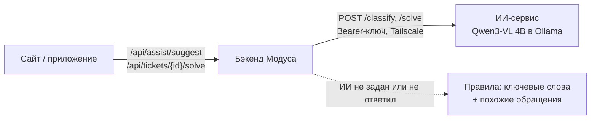

# ИИ-помощник

Подробности к [главному README](../README.md).

## Что делает

**Сотруднику при подаче.** Сотрудник пишет тему и описание, может приложить фото. Через секунду форма показывает подсказку: «Проблема · Интеграции и IT · получит Илья Соколов, ответ до 48 ч» и короткую причину выбора. Тип и категория подставляются сами. Если сотрудник выбрал их вручную, подсказка их не меняет и только предлагает «Применить».

**Ответственному в карточке обращения:**
- **Похожие обращения** — что уже было или есть сейчас, со статусом и тем, как решили. Ищутся только среди обращений, доступных этому руководителю.
- **«Предложить решение»** — ИИ даёт суть, 2–5 шагов и черновик ответа автору с опорой на похожие решённые обращения. Кнопки «В ответ автору» и «В результат» вставляют текст в поле; проверяет и отправляет человек.

ИИ ничего не решает и ничего не отправляет сам: он только подсказывает.

## Как устроено

- Модель: **Qwen3-VL 4B Instruct** (понимает текст и фото, хорошо знает русский), запущена через Ollama. Модель не дообучалась: задачу ей объясняет инструкция с описаниями 18 категорий и примерами из датасета заказчика.
- Сервис ИИ отделён от бэкенда и подключается тремя переменными: `AI_URL`, `AI_KEY`, `AI_TIMEOUT`. Его можно перенести на любой сервер или заменить облачной моделью без изменения кода.
- Сейчас модель работает на ноутбуке команды (RTX 4050, 6 ГБ) и доступна серверу только через защищённую сеть Tailscale. Из интернета она не видна.

## Точность и скорость

Замеры на 98 составленных примерах и 13 реальных обращениях из датасета:

| Показатель | Результат |
| --- | --- |
| Тип обращения | 96,4% |
| Категория, первая подсказка | 94,6% |
| Категория, одна из двух первых | 97,3% |
| Подсказка без фото / с фото | ~1,2 с / ~2,0 с |
| Вариант решения | 2,5–5,5 с |

Проверочные примеры составлены командой, поэтому на живых обращениях точность может быть ниже. Черновики решений у небольшой модели бывают общими — руководителю их нужно читать и править.

## Если ИИ недоступен

- При локальном запуске по README `AI_URL` не задан — подсказки работают на правилах: ключевые слова (включая названия систем вроде 1С и Битрикс) и категории похожих обращений. Ничего настраивать не нужно.
- Если сервис ИИ не ответил за `AI_TIMEOUT` секунд, бэкенд переходит на правила и 30 секунд не обращается к ИИ, чтобы форма не тормозила.
- Ошибочный ответ модели (несуществующая категория, неверный формат) не показывается — вместо него работают правила.

## Дальнейшее развитие

- Перенести модель на сервер компании или подключить корпоративный LLM-сервис.
- Дообучить на реальных обезличенных обращениях пилота и замерить точность на них.
- Искать похожие обращения по смыслу (векторный поиск), а не по словам.
