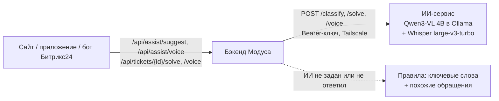

# ИИ-помощник

Подробности к [главному README](../README.md).

## Что делает

**Сотруднику при подаче.** Сотрудник пишет тему и описание, может приложить фото. Через секунду форма показывает подсказку: «Проблема · Интеграции и IT · получит Илья Соколов, ответ до 48 ч» и короткую причину выбора. Тип и категория подставляются сами. Если сотрудник выбрал их вручную, подсказка их не меняет и только предлагает «Применить».

**Голосом при подаче.** «Рассказать голосом» в приложении: сотрудник говорит своими словами («короче, в один эс оплата прошла, а в битриксе старый статус»), жмёт «Стоп». Через 3–5 секунд форма заполнена: короткая тема, описание деловым языком с исправленными названиями систем, тип и категория. Ничего не отправляется само: сверху плашка «Заполнено по голосу — проверьте», кнопки «Что я сказал» (дословная расшифровка) и «Вернуть как было».

**Голосовые сообщения в обсуждении** (сайт и приложение). Запись сохраняется и появляется у всех, кто открыл обращение, сразу. Через 1–3 секунды под ней появляется текстовая расшифровка — тоже без обновления страницы.

**Ответственному в карточке обращения:**
- **«Предложить решение»** — ИИ даёт суть, 2–5 шагов и черновик ответа автору по тексту обращения. Кнопки «В ответ автору» и «В результат» вставляют текст в поле; проверяет и отправляет человек.

ИИ ничего не решает и ничего не отправляет сам: он только подсказывает.

## Как устроено

- Модель: **Qwen3-VL 4B Instruct** (понимает текст и фото, хорошо знает русский), запущена через Ollama. Модель не дообучалась: задачу ей объясняет инструкция с описаниями 18 категорий (с границами между похожими) и примерами из датасета заказчика.
- Речь: **Whisper large-v3-turbo** на видеокарте (faster-whisper), со словарём компании (1С, Битрикс24, ЭДО…). Тему и описание по расшифровке пишет та же Qwen, а тип и категорию бэкенд определяет обычной классификацией по готовому тексту — так стабильнее.
- Сервис ИИ отделён от бэкенда и подключается переменными `AI_URL`, `AI_KEY` и таймаутами (`AI_TIMEOUT`, `AI_SOLVE_TIMEOUT`, `AI_VOICE_TIMEOUT`, `AI_CONNECT_TIMEOUT`). Его можно перенести на любой сервер или заменить облачной моделью без изменения кода.
- Сейчас модель работает на ноутбуке команды (RTX 4050, 6 ГБ) и доступна серверу только через защищённую сеть Tailscale. Из интернета она не видна.

## Точность и скорость

Замеры на 130 запросах: составленные командой примеры и реальные обращения из датасета.

| Показатель | Результат |
| --- | --- |
| Тип обращения | 96,2% |
| Категория, первая подсказка | 93,1% |
| Категория, одна из двух первых | 95,4% |
| Подсказка без фото / с фото | ~1,2 с / ~2,1 с |
| Вариант решения | 2,5–5,5 с |
| Голос → заполненная форма | 3–4 с на 15 с речи, ~4,3 с на 32 с речи; с сервера через сеть ~5,5 с |

Голос проверялся на синтетической речи без шума; живая речь с телефона может распознаваться хуже. Небольшая модель иногда искажает детали в описании — поэтому сотрудник всегда проверяет форму перед отправкой.

Проверочные примеры составлены командой, поэтому на живых обращениях точность может быть ниже. Черновики решений у небольшой модели бывают общими — руководителю их нужно читать и править.

## Если ИИ недоступен

- При локальном запуске по README `AI_URL` не задан — подсказки работают на правилах: ключевые слова (включая названия систем вроде 1С и Битрикс) и категории похожих обращений. Ничего настраивать не нужно.
- Если сервис ИИ не ответил за `AI_TIMEOUT` секунд, бэкенд переходит на правила и 30 секунд не обращается к ИИ, чтобы форма не тормозила.
- Ошибочный ответ модели (несуществующая категория, неверный формат) не показывается — вместо него работают правила.
- Если ИИ-сервис выключен, бэкенд понимает это за ~2,5 с (`AI_CONNECT_TIMEOUT`).

| Функция | Без ИИ |
| --- | --- |
| Тип и категория при подаче | правила, подпись «Подобрано автоматически по словам» |
| «Предложить решение» | недоступно: «Сервис подсказок временно недоступен» |
| Инструкции при подаче | работают — ИИ не нужен, поиск по словам опубликованных инструкций |
| «Рассказать голосом» | недоступно: сообщение «продиктуйте через микрофон на клавиатуре» |
| Голосовые сообщения | отправляются и проигрываются, но без расшифровки |

## Дальнейшее развитие

- Перенести модель на сервер компании или подключить корпоративный LLM-сервис.
- Дообучить на реальных обезличенных обращениях пилота и замерить точность на них.
- Искать похожие обращения по смыслу (векторный поиск), а не по словам.
