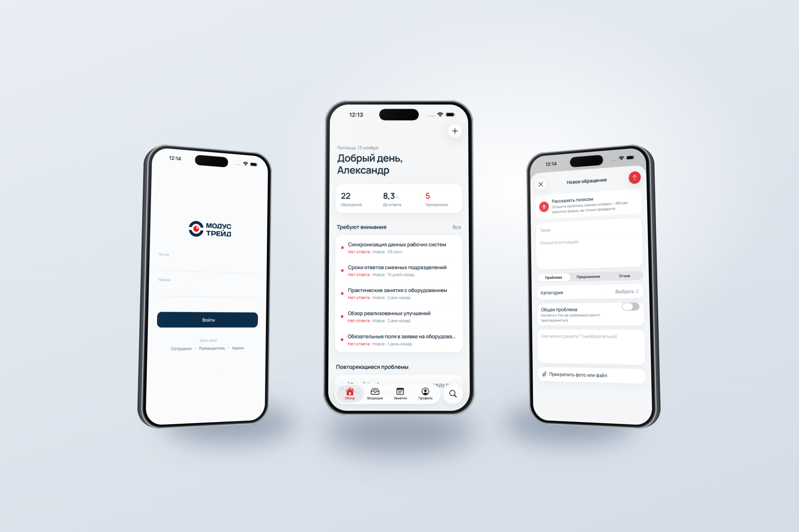
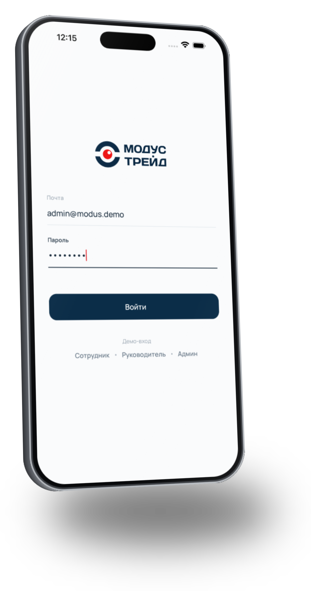
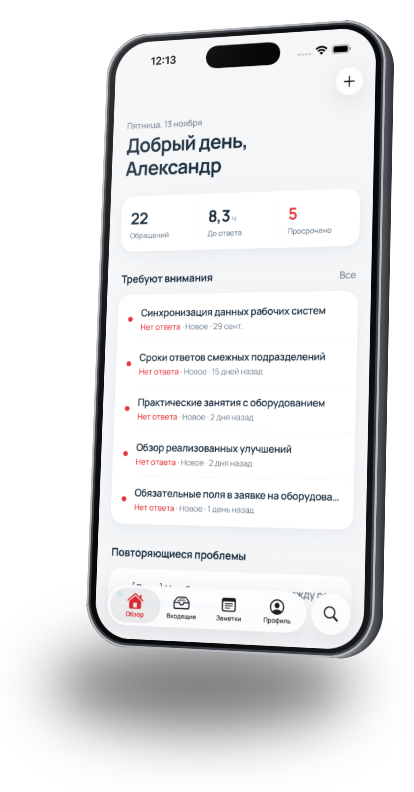
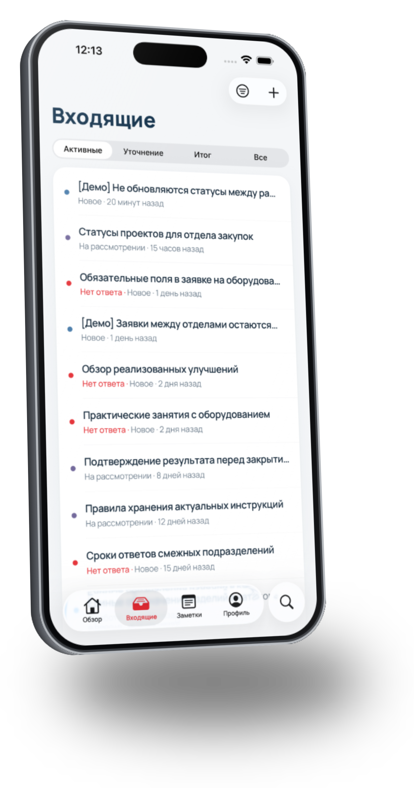
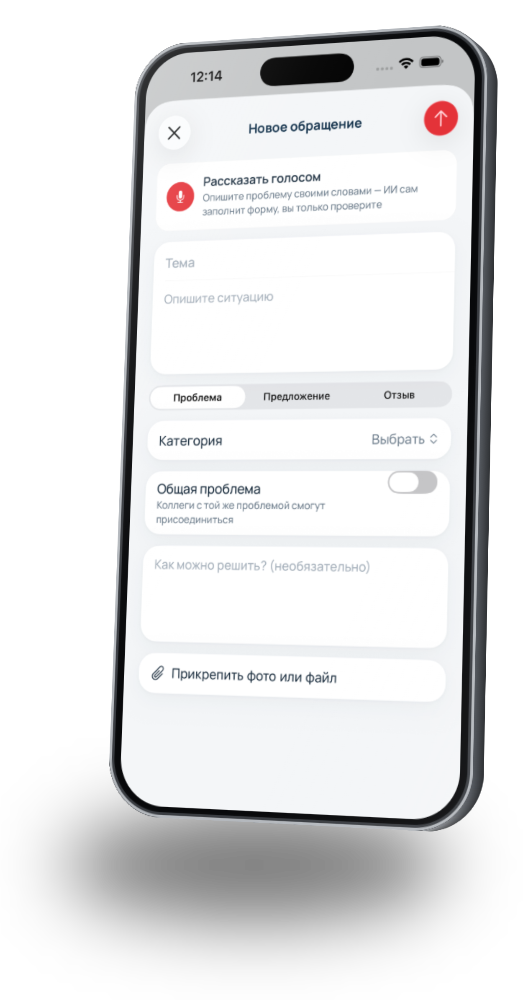
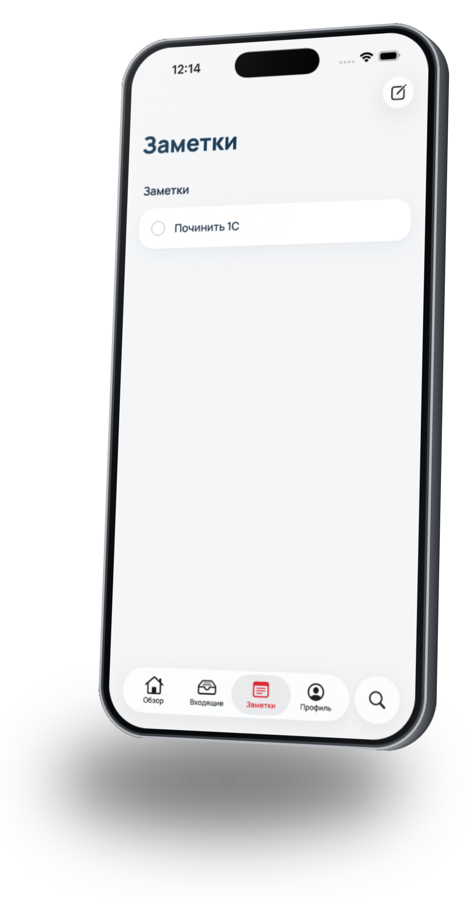
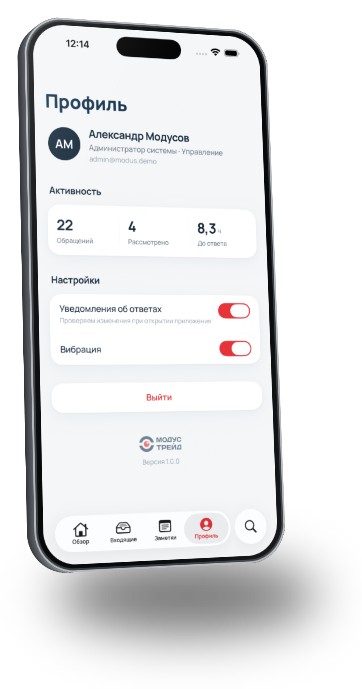
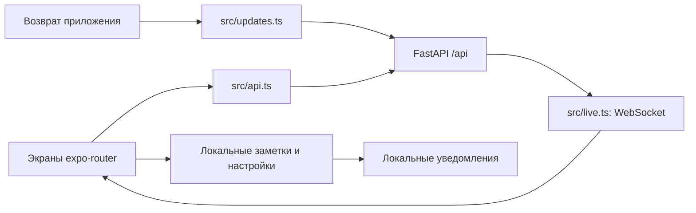

<div align="center">


# Модус · мобильное приложение

**Обращение, фото, голос и ответ руководителя — с телефона.**

[Весь проект](../README.md) · [Веб-демо](https://modus-trade.makquiz.site) · [Backend](https://github.com/Modus-trade/modus-back)
</div>

Мобильный клиент системы обратной связи сотрудников. Работает с тем же FastAPI и серверными данными, что и веб-версия. Сотрудник подаёт проблему или предложение и следит за ответом; исполнитель открывает назначенное обращение, обсуждает ситуацию и выполняет доступные действия.

Интерфейс ориентирован на iOS: большие заголовки, нативная навигация, SwiftUI-контролы и эффекты Liquid Glass на поддерживаемой системе. Код находится в `mobile/` общего репозитория `modus`; отдельного мобильного git-репозитория в этой структуре нет.



*Изображения мобильного интерфейса предоставлены командой 13.11.2026. Они показывают демонстрационные данные и открываются в исходном разрешении. Возможности описаны по текущему коду, а не только по изображениям.*

## Содержание

- [Вход и роли](#вход-и-роли)
- [Обзор](#обзор)
- [Входящие и карточка](#входящие-и-карточка)
- [Новое обращение](#новое-обращение)
- [Личные заметки](#личные-заметки)
- [Профиль и уведомления](#профиль-и-уведомления)
- [Запуск](#запуск)
- [Архитектура](#архитектура)
- [Отличия от веб-версии](#отличия-от-веб-версии)
- [Проверка и диагностика](#проверка-и-диагностика)

## Вход и роли

Пользователь входит с учётной записью Модуса. В демо есть быстрый выбор сотрудника, руководителя и администратора. Сервер ограничивает доступ независимо от того, используется сайт или телефон.

| Роль | Демо-логин | Пароль |
| --- | --- | --- |
| Сотрудник | `employee@modus.demo` | `demo1234` |
| Руководитель закупок | `manager.procurement@modus.demo` | `demo1234` |
| Администратор | `admin@modus.demo` | `demo1234` |

Сотрудник видит собственные и назначенные обращения, руководитель — обращения авторов своего подразделения и назначенные лично ему. Присоединение к общей проблеме даёт отдельное ограниченное представление, без доступа к приватной переписке автора.

<p align="center"></p>

*Вход: почта, пароль и демонстрационные роли.*

## Обзор

Начальный экран показывает приветствие, доступные показатели и обращения, которые требуют внимания. Отсюда можно открыть конкретную проблему, перейти ко всем входящим или начать новое обращение. Набор доступных данных зависит от роли и ответа API.

Повторяющиеся общие проблемы помогают увидеть, что затруднение касается нескольких коллег. Числа на скриншоте относятся к демонстрационной базе; это не фиксированные показатели продукта.

<p align="center"></p>

*Обзор: количество обращений, время ответа и проблемы без реакции.*

## Входящие и карточка

Список разделён на рабочие состояния. Сотрудник может быстро найти активное обращение, запрос уточнения или итог. В строке видны тема, статус и время, а цвет сопровождается текстовым обозначением.

Карточка содержит этапы обработки, описание, обсуждение, вложения и историю. Доступные исполнителю действия включают управление статусом, приоритетом, ответственным и результатом. В обсуждении поддерживаются голосовые сообщения: запись, проигрывание и расшифровка при доступном ИИ. Ответственный может запросить вариант решения у ИИ, но решение принимает и публикует человек.

<p align="center"></p>

*Входящие: фильтрация по рабочим состояниям и переход в обращение.*

## Новое обращение

Форма объединяет тему, описание, тип, категорию, предполагаемое решение и вложения. Можно прикрепить фото с камеры, из галереи или документ. При включении общей проблемы коллеги смогут присоединиться через поддерживаемый канал. Само создание обращения требует подтверждения пользователя.

«Рассказать голосом» записывает описание и отправляет его сервису распознавания. ИИ предлагает заполненные тему, описание, тип и категорию. Пользователь проверяет результат, может исправить его или вернуться к исходному варианту. При отсутствии ИИ остаётся ручное заполнение формы; автоматическое распознавание не работает полностью офлайн.

Вложения и комментарии сохраняются на сервере и доступны на сайте в пределах тех же прав. Разрешение на микрофон, камеру и доступ к файлам запрашивается устройством для соответствующего действия.

<p align="center"></p>

*Подача: голосовое заполнение и обычная форма с вложениями.*

## Личные заметки

Заметки помогают сохранить личное напоминание или небольшую задачу. Есть отметка выполнения и локальные напоминания. Они хранятся **на устройстве**, а не в реестре обращений: создание заметки не назначает исполнителя и не отправляет её руководителю.

Заметка не появляется автоматически на сайте или втором телефоне. Удаление приложения может привести к потере локальных данных. Для задачи, которую должна обработать компания, создавайте обращение.

<p align="center"></p>

*Заметки: личный список, отдельный от серверных обращений.*

## Профиль и уведомления

Профиль показывает имя, роль, подразделение, активность и настройки. Пользователь управляет вибрацией и уведомлениями и может выйти из аккаунта. Настройки интерфейса хранятся локально.

При работающем приложении WebSocket получает живые события. Кроме того, при возвращении приложения в активное состояние проверяются изменения обращений и сравниваются с последним сохранённым снимком. При разрешённых уведомлениях создаются локальные системные уведомления с переходом в карточку.

**Это не серверный push APNs/FCM.** Нельзя обещать мгновенное уведомление при полностью закрытом приложении. Для независимого от запуска Модуса канала можно использовать настроенные уведомления Битрикс24.

<p align="center"></p>

*Профиль: сведения об аккаунте и настройки устройства.*

## Запуск

### Требования

- Node.js 22+ и npm.
- iPhone с совместимой версией Expo Go либо Mac с Xcode и iOS Simulator.
- Доступ к API Модуса.
- Для воспроизведения внешнего вида iOS 26 — соответствующая версия системы. Android и полная функциональная идентичность платформ в этой поставке не подтверждены.

В `package.json` зафиксировано семейство Expo SDK 58, React Native 0.88 и React 19. При изменении SDK проверяйте совместимость Expo Go и нативных библиотек; обновление одной зависимости отдельно может нарушить сборку.

### С демонстрационным сервером

Из корня общего репозитория:

```sh
cd mobile
npm install
npx expo start
```

На iPhone отсканируйте QR-код. Компьютер и телефон должны находиться в сети, позволяющей соединение с Metro. Для симулятора на Mac нажмите `i` в терминале. Если установленный Expo Go не поддерживает SDK или используемый нативный модуль, понадобится совместимый клиент / development build; это не ошибка учётной записи Модуса.

По умолчанию приложение обращается к `https://modus-trade.makquiz.site`, локальный backend не нужен. Созданные в этом режиме обращения попадают именно на демонстрационный сервер.

### Со своим backend

Запустите backend на доступном телефону интерфейсе:

```sh
# В каталоге backend с активированным окружением
uvicorn app.main:app --host 0.0.0.0 --port 8000
```

Затем задайте адрес компьютера в локальной сети:

```sh
# В каталоге mobile
EXPO_PUBLIC_API_URL=http://192.168.1.10:8000 npx expo start
```

`192.168.1.10` — пример, замените своим адресом. Можно сохранить настройку в локальном `.env`:

```dotenv
EXPO_PUBLIC_API_URL=http://192.168.1.10:8000
```

На Windows PowerShell:

```powershell
$env:EXPO_PUBLIC_API_URL="http://192.168.1.10:8000"
npx expo start
```

Не добавляйте `/api` в конец значения: клиент сам формирует пути. `127.0.0.1` на физическом iPhone означает сам телефон. После изменения переменной перезапустите Metro. Серверный JWT-секрет, пароли 1С и вебхуки никогда не должны попадать в `EXPO_PUBLIC_*`.

## Архитектура



```text
app/
  _layout.tsx          корневая навигация и подключение общих механизмов
  login.tsx            вход
  (tabs)/              обзор, входящие, заметки, профиль и поиск
  ticket/[id].tsx      карточка обращения
  new.tsx              форма создания
  note.tsx             редактирование заметки
src/
  api.ts               HTTP-клиент, URL сервера и модели
  live.ts              WebSocket и обновление данных
  updates.ts           сравнение изменений при открытии
  notes.tsx            локальные заметки и напоминания
  settings.ts          настройки приложения
  voice.tsx            голосовое заполнение формы
  voiceMessage.tsx     запись и проигрывание сообщения
  insights.tsx         ИИ-помощь исполнителю
  native.tsx           нативные SwiftUI-контролы
  components.tsx       общие компоненты
  theme.ts, ui.tsx     палитра, шрифты и анимации
```

API использует сессионную httpOnly cookie; WebSocket получает токен по авторизованному запросу. В приложении нет отдельной базы обращений, которую нужно вручную «синхронизировать с сайтом»: совпадение данных определяется адресом сервера и пользователем.

## Отличия от веб-версии

| Возможность | Мобильный клиент | Веб |
| --- | --- | --- |
| Подача и просмотр обращений | Есть | Есть |
| Фото и файлы | Камера, галерея, документы | Выбор файлов |
| Голосовое заполнение обращения | Есть, нужен ИИ-сервис | Основная форма текстовая |
| Голосовые сообщения в обсуждении | Есть | Есть |
| Общие проблемы пользователя | Ограниченное представление | Ограниченное представление |
| Личные заметки | На устройстве | Не являются частью веб-реестра |
| Администрирование интеграций | Используйте сайт | Есть |
| Аналитика эффекта и рейтинги 1С | Используйте сайт | Есть |
| Редакционный процесс базы знаний | Используйте сайт | Есть |
| Уведомления при закрытом клиенте | Серверный push ещё не реализован | Внутрисистемный колокольчик; отдельная доставка в Битрикс |

Наличие API-функции не означает, что для неё уже сделан мобильный экран. Новые функции сервера и веба нужно отдельно переносить и проверять в мобильном клиенте.

## Проверка и диагностика

```sh
npm run typecheck
```

Проверка типов не заменяет запуск на iPhone. Основной ручной прогон:

1. Войти сотрудником, проверить роль и список обращений.
2. Создать обращение с понятной темой и фото; открыть его на сайте под той же учётной записью и на том же API.
3. На сайте добавить ответ; проверить обновление карточки на телефоне.
4. Открыть запрос уточнения и ответить с телефона.
5. Записать голосовое сообщение; проверить проигрывание и поведение при недоступной расшифровке.
6. Создать локальную заметку и напоминание; проверить, что они не появились как серверное обращение.
7. Изменить статус с сайта, свернуть и снова открыть приложение; проверить обновление.
8. Выйти, войти другой ролью; проверить границы видимости.

| Симптом | Что проверить |
| --- | --- |
| На сайте и телефоне разные обращения | `EXPO_PUBLIC_API_URL`, адрес сайта, аккаунт и отдел |
| Не подключается к локальному API | IP компьютера, порт 8000, `--host 0.0.0.0`, сеть и firewall |
| QR не открывает приложение | Совместимость Expo Go с SDK, доступность Metro |
| Нет микрофона / камеры | Разрешения iOS для приложения |
| Голос не превращается в текст | Доступность ИИ-сервиса и серверный лог; ручная форма остаётся доступной |
| Нет уведомления в закрытом приложении | В этой версии нет серверного push; сравнение выполняется при открытии |
| После перезапуска сервера пропал вход | Постоянный `JWT_SECRET` на backend |
| Изменение адреса не применилось | Перезапустить Metro и приложение |

Мобильный код и этот README коммитятся в общий `modus`. Копии frontend/backend изменяются через их исходные репозитории. Скриншоты расположены в `../docs/images/`; не заменяйте реальные снимки макетами несуществующих функций.
